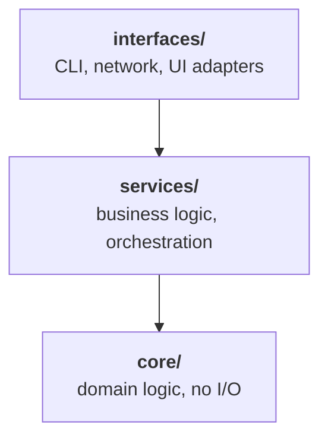

# C++ Architecture Guide

The rules every C++ change in N-Type follows, for AI coding agents and humans alike.

The point of this document is to give whoever writes or modifies code one
consistent set of decisions, so the codebase reads as if one person wrote it. It
covers ownership, error handling, layering, naming, abstraction, idioms, testing
and dependencies. Follow these rules unless a specific instruction in the task
overrides them. When unsure, pick the simpler, more explicit option.

- [1. Overview](#1-overview)
- [2. Ownership and memory](#2-ownership-and-memory)
- [3. Error handling](#3-error-handling)
- [4. Module and layer boundaries](#4-module-and-layer-boundaries)
- [5. Naming and structure](#5-naming-and-structure)
- [6. Interfaces and abstraction](#6-interfaces-and-abstraction)
- [7. Const-correctness and type idioms](#7-const-correctness-and-type-idioms)
- [8. Testing](#8-testing)
- [9. Build and dependencies](#9-build-and-dependencies)
- [10. Working on existing code](#10-working-on-existing-code)
- [11. Checklist](#11-checklist)

---

## 1. Overview

Three ideas shape every rule below:

1. **Ownership is visible in the types.** Who owns an object, and for how long,
   should be readable from its declaration: values and `std::unique_ptr` own,
   references and raw pointers only borrow.
2. **Dependencies flow one way.** Lower layers never know higher ones exist, so
   each layer can be understood, tested and reused on its own.
3. **The simplest thing that works wins.** No abstraction, dependency or clever
   trick until there is a concrete need for it. Code should be easy to read and
   easy to delete.

## 2. Ownership and memory

| Situation | Use |
|-----------|-----|
| Default | Stack allocation and value semantics |
| Lifetime must outlive the scope, or the object is large / polymorphic | `std::unique_ptr` (single owner) |
| Ownership is genuinely shared | `std::shared_ptr`, never as a default |
| Non-owning access | Raw pointer or reference |
| Files, sockets, locks and other resources | An RAII wrapper type |

- Never write raw `new` / `delete`.
- A function taking a raw pointer or reference never takes ownership and never
  deletes it.
- Follow the **Rule of Zero**: don't hand-write a copy constructor, copy
  assignment, move constructor, move assignment or destructor unless the class
  does genuinely novel resource ownership. The compiler-generated ones are less
  code to maintain and stay correct when members are added later.

## 3. Error handling

| Kind of failure | Mechanism | Example |
|-----------------|-----------|---------|
| Exceptional, unrecoverable at this level | Exception | Corrupted state, invalid input from outside the program's control |
| Expected, recoverable | Return value: `std::optional`, `std::expected`, or a result struct | "File not found" when checking is normal control flow |

- Pick **one convention per layer** and stay consistent. Never mix error codes and
  exceptions in the same subsystem.
- Never silently swallow an error. If you catch an exception, either handle it
  meaningfully or rethrow it.

## 4. Module and layer boundaries

Code is organised in layers with a one-directional dependency flow:

- A lower layer must never depend on a higher one: `core/` does not know that
  `interfaces/` exists.
- Keep headers minimal. Prefer a forward declaration over an `#include` when only
  a pointer or reference to a type is needed, and keep implementation details out
  of headers.
- One class or responsibility per file where reasonable. Avoid "god files" that
  mix unrelated concerns.

## 5. Naming and structure

| Element | Convention | Example |
|---------|------------|---------|
| Types | `PascalCase` | `GameLoop` |
| Functions, variables | `snake_case` | `fixed_step` |
| Constants | `kPascalCase` or `UPPER_SNAKE_CASE`, one of them consistently project-wide | `kMaxPlayers` |
| Namespaces | Mirror the folder structure and the layer, not an arbitrary grouping | `ntype::engine::ecs` |
| Files | Named after the primary type they define | `Player.hpp` → `class Player` |

No abbreviation that isn't immediately obvious: clarity beats brevity.

## 6. Interfaces and abstraction

| Do | Don't |
|----|-------|
| Introduce an abstract interface (pure virtual class) once there are **two real implementations**, or a concrete testing need | Abstract speculatively: it adds indirection without payoff |
| Prefer composition | Use inheritance for code reuse; keep it for genuine "is-a" polymorphism |
| Keep interfaces small: a few cohesive methods | Build catch-all interfaces |
| Mark every overriding function `override`, and `final` where no further overriding should happen | Leave overrides unmarked: a signature mismatch then silently creates a new virtual function instead of failing to compile |

## 7. Const-correctness and type idioms

| Rule | Why |
|------|-----|
| Mark everything `const` that isn't meant to change: parameters, methods, locals | Documents intent; the compiler catches accidental mutation |
| Pass and return small / primitive types (`int`, `bool`, `double`…) by value, not `const&` | A reference to a primitive is a pointer underneath, usually slower than a register |
| Avoid boolean parameters (`create_widget(true)`); use an enum or two clearly named functions | The meaning of `true` is invisible at the call site |
| Prefer standard algorithms (`std::transform`, `std::accumulate`, ranges…) over hand-rolled loops | A loop that only indexes a container with `[]` usually means an algorithm was skipped |
| Mark single-argument constructors and conversion operators `explicit` unless an implicit conversion is really intended | Prevents silent, surprising conversions |

## 8. Testing

- New non-trivial logic comes with a unit test **in the same change**.
- Tests live in a `tests/` tree that mirrors the code they test.
- Test behaviour through public interfaces, not internal implementation details.

## 9. Build and dependencies

- Don't add a third-party dependency for something the standard library already
  does well.
- Justify every new dependency in the commit message or PR description.
- Keep the build configuration (CMakeLists, etc.) in sync with the actual
  includes: no reliance on implicit or transitive includes.

## 10. Working on existing code

- **Match the file you are in.** When modifying existing code, follow that file's
  style even if it diverges slightly from this guide, rather than mixing
  conventions within one file.
- **Stay in scope.** Don't refactor unrelated code while completing a task unless
  asked.
- **Uncovered decisions.** When this guide says nothing, choose the option that is
  easiest to read and easiest to delete later. Avoid clever or over-engineered
  solutions.

## 11. Checklist

Before considering a change done:

- [ ] No raw `new` / `delete`; ownership readable from the types
- [ ] One error-handling convention in the touched subsystem, no swallowed errors
- [ ] No include pointing to a higher layer
- [ ] Names follow section 5
- [ ] No new interface without two implementations or a test need; overrides marked `override`
- [ ] `const` everywhere it applies; no boolean parameters; single-argument constructors `explicit`
- [ ] Tests added for new non-trivial logic
- [ ] Any new dependency justified; build files match the includes
